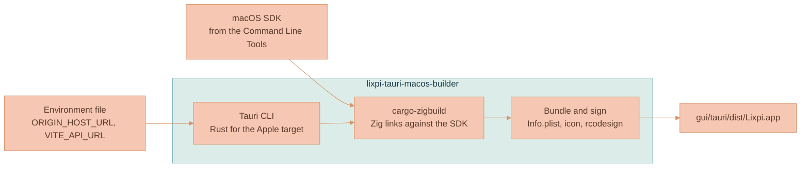

# Desktop App

The desktop app runs web-ui as a native macOS application: its own window, Dock icon, app menu and keyboard shortcuts, without a browser around it. It lives in `gui/tauri` and is built with Tauri 3, which wraps the system WebKit view in a small Rust program. Tauri 3 is still in alpha, so the project pins exact prerelease versions of Tauri, its plugins and its CLI.

## What the window loads

The window opens web-ui from the same origin a browser would use, such as `https://localhost:3443` for a local stack or `https://lixpi.ai` in production. It does not carry its own copy of web-ui. That choice follows from how the rest of the platform identifies the client:

- The auth client moves any page that isn't on its configured redirect origin back to that origin before it signs in, so a bundled copy served from Tauri's own `tauri://localhost` origin would be sent away immediately.
- The API's CORS policy admits only `ORIGIN_HOST_URL`, and NATS checks WebSocket origins the same way.

Because the window shows the real origin, sign-in, NATS, the API and, in a build with hot reload, Vite's live updates all work exactly as they do in a browser, and no service needs a desktop-specific allowance. The origin comes from the environment file used for the build. `ORIGIN_HOST_URL` sets the page the window opens and `VITE_API_URL` identifies the API, so each environment file produces an app for that environment.

A local stack serves HTTPS with certificates from its own certificate authority, which **Initialize infrastructure** creates in the `caddy-certs` volume. The app trusts that authority itself, so it works whether or not the authority is installed in the macOS keychain. A build whose web-ui URL is `https://localhost` or `https://127.0.0.1` embeds the authority from the volume, and fails with a clear message if the volume has none. Builds for any other environment embed nothing.

WebKit asks the app's navigation delegate whether to accept each server certificate, for the page, its subresources and the NATS WebSocket alike. wry's delegate doesn't answer that question, so on macOS the app adds the method to the delegate's class through the Objective-C runtime, then sets the delegate again so WebKit sees it. The window starts on a blank page and opens web-ui only after that, so the first request is already covered. For `localhost`, `127.0.0.1` and `::1` the method checks the server's chain against the embedded authority under the system's TLS policy, keeping the system's own anchors too, and accepts the certificate only when that check passes. Every other host, and every other kind of challenge, gets the system's default handling. This is the app's only unsafe code; it lives in `src/local_trust/macos.rs` with a reason for each unsafe operation.

The system's TLS policy still applies Apple's rule that a server certificate may be valid for at most 825 days, even under a trusted authority. Chrome doesn't apply that rule, so a certificate can work in Chrome and still fail in the app. Local issuance keeps the certificates NATS and the HTTPS gateway serve inside the limit, as the [Caddy certificate service](../../services/caddy/documentation/ARCHITECTURE.md) describes.

## Links, new windows and downloads

A desktop app has no tabs, so the window decides where each kind of request goes:

- Navigation inside web-ui, including the trip through the sign-in page, stays in the window.
- A request to open a new window on the API's origin, such as the workspace export, is saved as a download.
- Any other web link that would open a new window, such as the account page in the user portal, opens in the default browser.
- A navigation to an API URL with `download=true` is saved as a download instead of being shown. WebKit displays an image even when the API marks it as an attachment, so without this a media download would replace the workspace with the bare image.

The app saves downloads by fetching the file from inside the page and handing it to WebKit's download handling, which writes it to the Downloads folder without overwriting an existing file. The page's own origin is the one the API's CORS policy admits, and the API exposes the `Content-Disposition` header, so the file keeps its original name.

WebKit treats plain-HTTP `localhost` as insecure, unlike Chrome, and silently cancels a plain-HTTP frame inside an HTTPS page. The local auth client refreshes tokens in such a hidden frame, so the local HTTPS gateway serves LocalAuth0 at `https://localhost:3446` and the frontends use that origin. When NATS rejects a stored session, such as one from before LocalAuth0 restarted, the client fetches a new token in the background and reconnects, in Safari and the desktop app as in Chrome. The refresh keeps its time limit, so a refresh that can't complete still ends at the sign-in screen instead of loading forever.

The page has no access to Tauri's native commands. The app grants no capabilities to the remote origin, so web-ui runs with exactly the permissions it has in a browser.

The window remembers its size and position between launches.

## Hot reload, reloading and developer tools

The window loads web-ui from the Vite dev server on a local stack, so a build with hot reload follows web-ui the way a browser tab does: Vite pushes each rebuilt module to the page over its WebSocket, and reloads the page when a change can't be applied in place. Hot reload is a build option, on by default. A build without it, such as one made for a release, installs a script before any page script runs that refuses the WebSockets Vite opens for updates, which it recognizes by their `vite-hmr` and `vite-ping` subprotocols. The page then stays as it loaded until it's reloaded. A production web-ui has no Vite client, so the switch only changes anything against a dev server. The option compiles the crate's `hot-reload` feature.

A bare web view has no browser menu, so the app's View menu adds the two commands a developer reaches for:

| Command | Shortcut | What it does |
|---------|----------|--------------|
| Reload | Cmd+R (Ctrl+R elsewhere) | Reloads the page. When the window is still on its starting blank page, because web-ui wasn't reachable at launch, it opens web-ui instead |
| Developer Tools | Option-Cmd-I or F12 (Ctrl+Shift+I or F12 elsewhere) | Shows the WebKit inspector, or hides it when it's open |

Both are menu key equivalents, so they work while the page is busy or broken. The inspector shortcut is the one Safari and Chrome use. Plain Cmd+I stays with the page, where the editors use it for italic. A menu item holds one shortcut, so the app catches F12 through an AppKit local event monitor in `src/keyboard/macos.rs`, and leaves F12 to the page when a modifier key is held. Every build has the inspector, which can also be opened with **Inspect Element** from the page's context menu.

## Rendering at the display's refresh rate

WebKit runs `requestAnimationFrame` near 60 frames a second by default, even on a 120 Hz ProMotion display, where Chrome runs at 120. Every canvas animation, pan and zoom follows that rate, so the canvas felt slower in the app than in Chrome. Before web-ui loads, the app turns off WebKit's `PreferPageRenderingUpdatesNear60FPSEnabled` feature flag, the same switch as Safari's "Prefer Page Rendering Updates near 60fps", so the page renders at the display's own rate. WebKit lists its feature flags only through private API, so the app looks the flag up by name and logs `Page animation stays near 60 frames per second` on stderr when a WebKit version doesn't have it. The canvas itself runs on Pixi, which uses WebGPU when the view offers it, as WebKit on current macOS does.

## Debugging the app

The app is a thin window around web-ui, so most problems are in the page, in the TLS connections it opens, or in the services behind it. Each has its own place to look.

### Diagnostics builds

A build with diagnostics turned on records what happens inside the page. It captures console output, uncaught errors, unhandled promise rejections and blocked requests from the moment each page starts, together with every page load. It writes them to stderr and to `~/Library/Logs/com.lixpi.desktop/diagnostics.log`, because an app opened from Finder has no terminal. Access tokens, both `token=` values and anything shaped like a JSON Web Token, are redacted before anything is written.

Choose **Debug mode: On** in **Build the macOS desktop app**, or set `LIXPI_DESKTOP_DIAGNOSTICS=true` on the build command. It compiles the crate's `diagnostics` feature, which normal builds leave out. Each line starts with a Unix timestamp in milliseconds:

```text
[1794127180655] page started: https://localhost:3443/
[1794127181476] info /: NATS -> listening on: wss://localhost:9222
[1794127182477] rendering /: 118 frames per second devicePixelRatio 2 WebGPU available
[1794127183012] error /: NATS -> authorization failed, refreshing credentials {"name":"AuthorizationError"}
```

A second after each page loads, the log records a `rendering` line: the frame rate the page actually got, the device pixel ratio, and whether WebGPU is available. Compare it with the display's refresh rate when the canvas feels slow.

### For people

- Follow the page as it runs with `tail -f ~/Library/Logs/com.lixpi.desktop/diagnostics.log` while using a diagnostics build.
- Open the WebKit inspector with Option-Cmd-I, F12 or **Inspect Element** in the page's context menu. Every build has it, diagnostics or not, and it shows the console, network requests, storage and the DOM. Safari can attach to the same page from **Develop**, once **Show features for web developers** is on in Safari's settings.
- Run the binary from a terminal, `gui/tauri/dist/Lixpi.app/Contents/MacOS/Lixpi`, to see the app's own messages on stderr, such as a failed download or a window that couldn't open.

### For agents

Agents must not inspect the window, take screenshots or drive the page. Everything below reads logs and process state instead.

1. Build with diagnostics on and open the app:

    ```bash
    LIXPI_DESKTOP_DIAGNOSTICS=true COMPOSE_IGNORE_ORPHANS=true docker compose --env-file .env.<stage> -f infrastructure/docker/utilities/desktop/docker-compose.tauri.yml run --rm lixpi-tauri-macos-builder
    open gui/tauri/dist/Lixpi.app
    ```

2. Read `~/Library/Logs/com.lixpi.desktop/diagnostics.log`. It shows whether the page loaded, what web-ui logged and every uncaught error. A page that never logs `NATS -> listening` stopped before connecting; `authorization failed` means NATS rejected the session.
3. List the connections the page holds. A live session has the web-ui gateway and NATS open:

    ```bash
    for p in $(pgrep -f com.apple.WebKit.Networking); do lsof -nP -a -p "$p" -iTCP; done
    ```

4. Read WebKit's TLS decisions from the system log. Each accepted connection shows `Returning from external verify block with result: true` followed by `TLS connected`:

    ```bash
    /usr/bin/log show --last 5m --info --debug --style compact --predicate 'processImagePath CONTAINS "WebKit.Networking"' | grep -E 'external verify block|TLS connected|handshake'
    ```

5. Read the services. `docker logs --since 5m lixpi-nats-1` shows `TLS handshake error ... unknown certificate` when a client rejected the certificate and `authentication error` when it presented a session NATS refused. The API reports its readiness at `/health-check` inside its container. `docker logs lixpi-local-https` covers the HTTPS gateway.
6. Check a certificate the way macOS does: `security verify-cert -c leaf.pem -c intermediate.pem -p ssl -s localhost`, with the chain copied from `openssl s_client -connect localhost:<port> -showcerts`.

Never print an access token while debugging. The diagnostics log is redacted, but the app's web storage under `~/Library/WebKit/com.lixpi.desktop` isn't; decode only a token's timestamps when they matter.

## Building the app

Tauri can only bundle a macOS app on a Mac, and the repository runs every tool in Docker. The `lixpi-tauri-macos-builder` utility closes that gap by cross-compiling from Linux:



Rust compiles the app for `aarch64-apple-darwin` or `x86_64-apple-darwin`, and Zig links it against the macOS SDK. The builder shares the application's Compose project, like the certificate generator, so it can read the local authority from the `caddy-certs` volume. The SDK comes from the Command Line Tools on the developer's own Mac. Docker Desktop can't bind-mount `/Library`, so Compose passes the SDK directory to the image build as an extra build context, and the image keeps a copy at `/opt/macos-sdk`. The image never downloads the SDK, and it stays local because it is never pushed. `MACOS_SDK_PATH` in the environment file names the SDK; change it to build against a different one, then rebuild the builder image.

The Tauri bundler skips macOS bundles on Linux, so the build script compiles with `cargo tauri build --no-bundle` and assembles `Lixpi.app` itself. The `Info.plist` has the keys the bundler writes, filled from `tauri.conf.json`. `rcodesign` then gives the bundle an ad-hoc signature, which Apple silicon requires before it runs any app. The icons are rendered from `gui/tauri/app-icon.svg` whenever it changes. The icon repeats the company website's hero: its four greens at the freeform gradient's starting points with the renderer's falloff, its soft white glow and inner highlight, and the Lixpi mark in night blue on a macOS rounded-square tile. The five icons `tauri.conf.json` lists are committed, because the Rust runners compile the crate without running the builder.

Run **Build the macOS desktop app** from `./run.sh`. It asks for the environment file, then shows one page for the Mac's processor, hot reload (**On** by default, **Off** for a release), debug mode and whether to rebuild the builder image, then leaves the app at `gui/tauri/dist/Lixpi.app`. The same build without the console is:

```bash
docker compose --env-file .env.<stage> -f infrastructure/docker/utilities/desktop/docker-compose.tauri.yml run --rm lixpi-tauri-macos-builder
```

Without the console, the build takes `LIXPI_DESKTOP_TARGET`, `LIXPI_DESKTOP_DIAGNOSTICS` and `LIXPI_DESKTOP_HOT_RELOAD` from the environment file: `x86_64-apple-darwin` for an Intel Mac, `true` for a diagnostics build, `false` for a build without hot reload. The console's choices override them for its builds. The Cargo registry and build output live in the `cargo-registry` and `cargo-target` volumes, so later builds compile only what changed. Open the result with `open gui/tauri/dist/Lixpi.app`, or move it to Applications.

The app's Rust code is formatted, linted and tested by the shared Rust runners under the `desktop` target, which compile it natively on Linux so CI can run them. Its tests cover the decisions the window makes: which navigations become downloads, where a new window goes, how a download URL enters the page script, which URLs the build accepts, what Reload does with the current page, which menu items and keys run a command, and when the hot reload script is installed. [Rust Testing and Tooling](../code-quality/testing/RUST.md) has the commands.

The ad-hoc signature lets the app run on the Mac that built it. Sharing the app with other people needs a Developer ID certificate and Apple's notarization, which this build doesn't do.

## Versions

The Rust crates are pinned in `gui/tauri/src-tauri/Cargo.toml` and `Cargo.lock`. Tauri 3 separates its core from the runtime that drives the web view, and an app that doesn't choose one fails at launch with `RuntimeNotConfigured`, so the app depends on `tauri-runtime-wry` and selects it in `lib.rs`. The builder's tools, which are Zig, `cargo-zigbuild`, the Tauri CLI and `apple-codesign`, are selected in the [Dependency Version Registry](../../dev-tools/versions-registry/README.md) like every other tool, and the Rust image is the same `rust` image the LocalAuth0 build uses. The Tauri CLI follows the Tauri 3 prerelease line, so an update proposes the newest published CLI even while it is a prerelease. Keep the CLI and the `tauri` crates on the same alpha when updating either.
