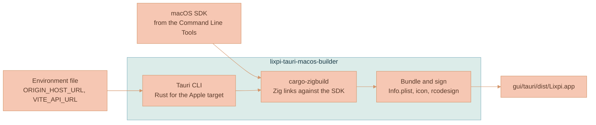

# Desktop App

The desktop app runs web-ui as a native macOS application: its own window, Dock icon, app menu and keyboard shortcuts, without a browser around it. It lives in `gui/tauri` and is built with Tauri 3, which embeds Chromium through the Chromium Embedded Framework (CEF). Tauri 3 is still in alpha, so the project pins exact prerelease versions of Tauri, its plugins and its CLI.

## What the window loads

The window opens web-ui from the same origin a browser would use, such as `https://localhost:3443` for a local stack or `https://lixpi.ai` in production. It does not carry its own copy of web-ui. That choice follows from how the rest of the platform identifies the client:

- The auth client moves any page that isn't on its configured redirect origin back to that origin before it signs in, so a bundled copy served from Tauri's own `tauri://localhost` origin would be sent away immediately.
- The API's CORS policy admits only `ORIGIN_HOST_URL`, and NATS checks WebSocket origins the same way.

Because the window shows the real origin, sign-in, NATS, the API and, in a build with hot reload, Vite's live updates all work exactly as they do in a browser, and no service needs a desktop-specific allowance. The origin comes from the environment file used for the build. `ORIGIN_HOST_URL` sets the page the window opens and `VITE_API_URL` identifies the API, so each environment file produces an app for that environment.

A local stack serves HTTPS with certificates from its own certificate authority, which **Initialize infrastructure** creates in the `caddy-certs` volume. A build for `localhost`, any subdomain of `localhost`, `127.0.0.1` or `::1` embeds that authority and fails if the volume has none. Other environments embed no authority. The build never installs it in the macOS keychain.

The app supplies the embedded authority through Chromium's profile preference `certificates.ca_certificates_with_constraints`. Its permitted DNS subtree is `localhost`, and its permitted IP ranges are exactly `127.0.0.1/32` and `::1/128`. Both constraint types are supplied because an omitted type would be unrestricted. The trust lives in the profile rather than in CEF's certificate-error callback, because CEF can reject a failing certificate for a subresource or a WebSocket before that callback runs, so an exception granted there would cover only the main page. Chromium's normal certificate verifier still checks the server's signature, expiry and hostname for HTTPS and WSS. Public certificates retain normal Chromium trust. A build without an embedded authority writes an empty preference to remove a previous local build's persisted anchor.

The window starts at `about:blank`. Before navigating to web-ui, the app checks that the preference is registered and writable, writes it with error handling, and compares its readback with the expected value. It also waits for that exact blank page to finish loading, because CEF defers its initial navigation until document-start scripts are registered. Once both conditions hold, the app queues one Web UI navigation outside the Chromium load callback. This gives Chromium time to finish processing the blank page before the HTTPS navigation starts. A missing, rejected or different preference stops startup. Certificate errors are cancelled; the app does not offer an exception interstitial or pass certificate-ignore switches. These checks establish the configured trust policy; a successful build alone does not establish live HTTPS or WSS connectivity.

## Links, new windows and downloads

A desktop app has no tabs, so the window decides where each kind of request goes:

- Navigation inside web-ui, including the trip through the sign-in page, stays in the window.
- A request to open a new window on the API's origin, such as the workspace export, is saved as a download.
- Any other web link that would open a new window, such as the account page in the user portal, opens in the default browser.
- A navigation to an API URL with `download=true` is saved as a download instead of being shown. This keeps the workspace open when an asset endpoint could otherwise be displayed in the window.

The app saves downloads by fetching the file from inside the page and handing it to Chromium's download handling. It selects the Downloads folder and reserves an unused filename atomically, adding a numeric suffix when the name is already taken. This also prevents simultaneous downloads from choosing the same filename. A failed download can leave an empty reservation file. The page's own origin is the one the API's CORS policy admits, and the API exposes the `Content-Disposition` header, so the file keeps its original name.

LocalAuth0 uses the local HTTPS gateway at `https://localhost:3446`, so hidden-frame token refresh works across the supported browsers and the desktop app. When NATS rejects a stored session, the client refreshes its token in the background and reconnects. While the API restarts after a code change, the client retries with its cached token at most 2 seconds apart rather than signing out. The refresh keeps its time limit, so a refresh that cannot complete returns to the sign-in screen.

Apart from dragging the window, described in the next section, the page has no access to Tauri's native commands, so web-ui runs with the permissions it has in a browser.

The window remembers its size and position between launches.

Chromium encrypts persisted cookies and saved passwords with a key it keeps in the login keychain, under Lixpi's own service `Lixpi Safe Storage` and account `com.lixpi.desktop`. The browser profile lives at `~/Library/Caches/com.lixpi.desktop/cef-protected`. The app has no profile-import or migration path, so the first launch with this profile requires signing in again. The key is unrelated to the embedded development certificate authority. Chromium's mock encryption key is not used, because its value is public and would give copied cookie data no protection.

macOS asks for the login password before a newly built app can read that key. The keychain identifies self-signed code by the hash of its executable, so every rebuild counts as a new app even though the signing certificate stays the same, and **Always Allow** covers only the build that is running. Denying the request leaves Chromium without encryption: `cef.log` reports `Encryption is not available`, and saved sessions stop working. The end of [Building the app](#building-the-app) describes the signing change that would remove the prompt.

## Title bar

On macOS the window has no native title bar. web-ui fills the whole window, starting at its top edge, and the traffic lights float over the page's top-left corner. Tauri's overlay title bar style sets this up, and the app moves the buttons so they sit centred in the page's title-bar row. After attaching and laying out the initial CEF view, the runtime reapplies that position on the next AppKit run-loop turn, because native startup layout can reset the earlier placement. Existing resize, focus and appearance handlers continue to maintain the same position.

The page draws that row itself, so it belongs to the interface rather than sitting above it as a grey strip. A script that runs before any page script marks `<html>` with `data-title-bar="overlay"` and sets `--window-title-bar-height` and `--window-controls-inset`, the space the three buttons need. Chromium can run that script before `<html>` exists, so the script watches for the element's insertion and marks it then. In a browser none of this is set, and web-ui looks as it always has.

The row holds the panel toggles. Both of web-ui's panels are the shared application panel from `@lixpi/ui-kit/components/application-panel`, and its stylesheet defines the title bar variables. While a panel is open its header becomes the row under the traffic lights, and its toggle sits just outside the panel's edge. When the left panel closes its toggle slides to just after the traffic lights, with a clear gap to their right; the right panel's toggle shows the same icon, mirrored, and closes to the row's right end. They are the same buttons the browser shows, positioned through `--window-title-bar-active`, which is 1 while the row shows and 0 otherwise, so each toggle position picks its desktop or browser value in one `calc()`. The app places the traffic lights so their centres line up with the toggles.

web-ui's `WindowTitleBar` handles the rest for the life of the page, from sign-in onwards:

- Because controls live in the row, no element covers it. Instead a capturing `pointerdown` listener treats a press in the row that doesn't land on a control (a button, link, field, focusable element or resize handle) as a press on the title bar. That press drags the window, and a double click that stays in place zooms it, as on a native title bar. The page never sees those presses, so pressing the row above the canvas doesn't also pan it. Like any overlay title bar, it can't drag the window until the window is focused, so the first click on an inactive window only focuses it.
- The traffic lights sit in an action panel oval, the same component and height as the panel toggles, so they stay readable over a canvas or a conversation. The row is tall enough that the oval sits as far below the window's top edge as from its left edge, and every oval in the row keeps that margin above and below it, which also leaves room for the canvas glass rim. The closed navigation toggle sits just after the oval, and while the navigation panel is open the toggle sits just outside its edge, over the canvas.

Dragging needs two of Tauri's window commands, `start_dragging` and `internal_toggle_maximize`. At startup the app grants them to the web-ui origin in the main window, and nothing else. In full screen macOS hides the traffic lights and slides its own title bar in on demand, so the app tells the page by setting `data-window-fullscreen` on `<html>` after each page load and resize. The page then hides the traffic light oval, stops treating the row as a title bar and puts the controls back in their browser positions. After a page load, fullscreen synchronization runs on a worker so the synchronous window query cannot block CEF's native callback.

## Hot reload, reloading and developer tools

The window loads web-ui from the Vite dev server on a local stack, so a build with hot reload follows web-ui the way a browser tab does: Vite pushes each rebuilt module to the page over its WebSocket, and reloads the page when a change can't be applied in place. Hot reload is a build option, on by default. A build without it, such as one made for a release, installs a script before any page script runs that refuses the WebSockets Vite opens for updates, which it recognizes by their `vite-hmr` and `vite-ping` subprotocols. The page then stays as it loaded until it's reloaded. A production web-ui has no Vite client, so the switch only changes anything against a dev server. The option compiles the crate's `hot-reload` feature.

A bare web view has no browser menu, so the app's View menu adds the two commands a developer reaches for:

| Command | Shortcut | What it does |
|---------|----------|--------------|
| Reload | Cmd+R (Ctrl+R elsewhere) | Reloads the page. When the window is still on its starting blank page, because web-ui wasn't reachable at launch, it opens web-ui instead |
| Developer Tools | Option-Cmd-I or F12 (Ctrl+Shift+I or F12 elsewhere) | Shows Chromium DevTools, or hides it when it's open |

Both are menu key equivalents. On the Web UI origin, Reload gives the outgoing document one frame to paint an opaque cover before navigating. The incoming document paints the same cover from its HTML, using the previous display scheme when available, and keeps it behind the usual startup spinner until the first application view is ready. A blank window opens the configured web app, and external pages use ordinary native reload. The inspector shortcut is the one Safari and Chrome use. Plain Cmd+I stays with the page, where the editors use it for italic. A menu item holds one shortcut, so the app catches F12 through an AppKit local event monitor in `src/keyboard/macos.rs`, and leaves F12 to the page when a modifier key is held. The AppKit monitor queues F12 presses to one worker, which preserves their order and lets the native event loop answer synchronous DevTools queries. Every build has the inspector, which can also be opened with **Inspect Element** from the page's context menu.

## Rendering

Chromium schedules and presents the page's frames. The canvas uses the shared Pixi renderer configuration, which prefers WebGPU when it's available, and the app adds no renderer selection or engine preferences of its own.

The app embeds Chromium instead of the macOS WebKit view because of WebGPU presentation stalls. A native sample of WebKit's content process during a panel transition found 50 of 279 main-thread samples in `GPUCanvasContextCocoa::prepareForDisplay`, waiting on synchronous IPC to WebKit's GPU process. That shows a presentation wait outside the application's own draw call, though it didn't identify the GPU-process operation or account for every stall. A comparison of WebGPU and WebGL in Chrome, two runs each, didn't show either renderer as consistently faster, so neither is forced. The [Chromium runtime record](../memory/DESKTOP-CHROMIUM-RUNTIME.md) has the measurements. The Chromium app's own rendering performance hasn't been measured.

## Debugging the app

The app is a thin window around web-ui, so most problems are in the page, in the TLS connections it opens, or in the services behind it. Each has its own place to look.

### Diagnostics builds

A build with diagnostics turned on records what happens inside the page. It captures console output, uncaught errors, unhandled promise rejections and blocked requests from the moment each page starts, together with every page load. It writes them to stderr and to `~/Library/Logs/com.lixpi.desktop/diagnostics.log`, because an app opened from Finder has no terminal. Access tokens, both `token=` values and anything shaped like a JSON Web Token, are redacted before anything is written.

Choose **Debug mode: On** in **Build the macOS desktop app**, or set `LIXPI_DESKTOP_DIAGNOSTICS=true` on the build command. It compiles the crate's `diagnostics` feature, which normal builds leave out. Startup logs its native entry, completion of Chromium initialization, entry into the AppKit event loop and window creation. Once the window exists, it records the Chromium version, whether native profiling was compiled in, the keychain service and profile used for encrypted storage, and the successfully verified development-CA scope or empty authority. A failed trust initialization is also logged, without certificate bytes or URL secrets. Each line starts with a Unix timestamp in milliseconds:

```text
[1794127180655] page started: https://localhost:3443/
[1794127181476] info /: NATS -> listening on: wss://localhost:9222
[1794127183012] error /: NATS -> authorization failed, refreshing credentials {"name":"AuthorizationError"}
```

Page logs drain through a persistent Chromium DevTools-protocol observer. The worker tracks one evaluation request, matches its allocated ID, and waits up to ten seconds for its response. A missing result during navigation is retired before the next poll, so it cannot leave capture waiting forever or accumulate pending callbacks. The native callback only queues the result; it never unregisters itself. This avoids the one-shot evaluation observer in CEF runtime alpha.7, whose callback can destroy its own locked mutex. Console capture and token redaction remain enabled independently of profiling.

Chromium writes native warnings and failures to `~/Library/Caches/com.lixpi.desktop/cef-protected/cef.log`. For a native crash, inspect that file alongside the app's diagnostics and the corresponding macOS report in `~/Library/Logs/DiagnosticReports/`.

To include native performance probes, choose **Profiling: On** in **Build the macOS desktop app**. The row defaults to **Off** and is independent of **Debug mode**. For a direct Docker build, pass `-e LIXPI_DESKTOP_PROFILING=true` after `docker compose run --rm` in the builder command. This enables the Cargo `profiling` feature and implies diagnostics. The default diagnostics build keeps console and error logging. The startup rendering sample and native timing probes are compiled only into profiling builds. Use the [Web UI profiler](DEVELOPMENT.md#profiling-the-web-ui) separately when you need page timings.

A second after each page loads with native profiling enabled, the log records a `rendering` line with the number of `requestAnimationFrame` callbacks per second, the device pixel ratio, and whether WebGPU is available. Measuring on-screen presentation requires compositor or native frame timings.

With native profiling enabled, each log poll also schedules a native main-thread task and measures the JavaScript drain's roundtrip. A delay of at least 50 ms produces a `responsiveness` line with `scheduledAt` (Unix milliseconds), `nativeQueueMs` and `webviewRoundtripMs`. Native queue delay is reported immediately, with the roundtrip marked `pending`, even if the page never replies. The completed roundtrip includes native scheduling, Chromium IPC, page execution, callback delivery and the worker receiving its response; it is not a measurement of JavaScript execution alone. Compare the shared scheduling timestamp and the page's client-performance timestamps to distinguish a blocked native loop from a delay elsewhere in the web view. A one-second probe can miss shorter stalls between samples.

The early native milestones are written synchronously so they are available if launch stalls. Other log parsing, token redaction, stderr output and file writes run on a dedicated writer thread. Native callbacks enqueue into a bounded queue without waiting; if the writer falls behind, it reports the number of dropped records when it resumes. Each log line retains the time it was queued, so disk delays do not change the timestamp used for correlation.

### For people

- Follow the page as it runs with `tail -f ~/Library/Logs/com.lixpi.desktop/diagnostics.log` while using a diagnostics build.
- Open Chromium DevTools with Option-Cmd-I, F12 or **Inspect Element** in the page's context menu. Every build has it, diagnostics or not, and it shows the console, network requests, storage and the DOM.
- Open a newly built app with `open gui/tauri/dist/Lixpi.app`.
- Run the binary from a terminal, `gui/tauri/dist/Lixpi.app/Contents/MacOS/Lixpi`, to see the app's own messages on stderr, such as a failed download or a window that couldn't open.

### For agents

Build and read logs through Docker. Ask the developer to install, relaunch and reproduce by default. Use native UI tools for those actions only when the developer explicitly authorizes them for the target app. Use logs to verify the result.

1. Build with diagnostics enabled and native profiling disabled unless profiling is explicitly requested. Replace `<stage>` with the environment being investigated.

    ```bash
    COMPOSE_IGNORE_ORPHANS=true docker compose --env-file .env.<stage> -f infrastructure/docker/utilities/desktop/docker-compose.tauri.yml run --rm -e LIXPI_DESKTOP_DIAGNOSTICS=true -e LIXPI_DESKTOP_PROFILING=false lixpi-tauri-macos-builder
    ```

2. Ask the developer to install and open the built app. Read a bounded excerpt of its diagnostics log through a read-only Docker mount.

    ```bash
    docker run --rm --network none --mount type=bind,source="$HOME/Library/Logs/com.lixpi.desktop",target=/desktop-logs,readonly --entrypoint sh lixpi/web-ui -c 'tail -n 200 /desktop-logs/diagnostics.log'
    ```

3. Check the page-load, console and connection evidence for the reported problem. If the page stops before `NATS -> listening` or reports `authorization failed`, inspect bounded recent NATS, API and HTTPS-gateway logs. A successful build does not verify launch, helper sandbox behavior, sign-in, downloads or live HTTPS/WSS.

Native profiling remains a separate opt-in build feature. Web UI profiling uses `VITE_CLIENT_PERFORMANCE_DEBUG`, which defaults to `false`. Do not enable either to verify a normal runtime migration or run stress workloads without an explicit request.

Keep access tokens out of debugging output. Use the redacted diagnostics log for session errors.

## Building the app

Tauri can only bundle a macOS app on a Mac, and the repository runs every tool in Docker. The `lixpi-tauri-macos-builder` utility closes that gap by cross-compiling from Linux:



Rust compiles the app for `aarch64-apple-darwin` or `x86_64-apple-darwin`, and Zig links it against the macOS SDK. CMake and Ninja compile CEF's C++ wrapper using the Darwin toolchain in `gui/tauri/toolchain`; both the archiver and its indexer use Zig, because GNU `ranlib` corrupts the Darwin archive. The builder has a 4 GB memory limit and no CPU or compiler-job cap. Cargo and CMake use their normal parallelism defaults. The builder shares the application's Compose project, like the certificate generator, so it can read the local authority from the `caddy-certs` volume. The SDK comes from the Command Line Tools on the developer's own Mac. Docker Desktop can't bind-mount `/Library`, so Compose passes the SDK directory to the image build as an extra build context, and the image keeps a copy at `/opt/macos-sdk`. The image never downloads the SDK, and it stays local because it is never pushed. `MACOS_SDK_PATH` in the environment file names the SDK; change it to build against a different one, then rebuild the builder image.

The Tauri bundler skips macOS bundles on Linux, so the build script compiles with `cargo tauri build --no-bundle` and assembles `Lixpi.app` itself. The shared `bundle-macos-app.sh` assembles the app, the Chromium framework and the five Helper, GPU, Renderer, Plugin and Alerts app bundles. Their entry point is the unchanged official helper source from [the pinned Tauri commit](https://github.com/tauri-apps/tauri/blob/81bfb7ca8f1a17be1e48c9b0d167c77b2137f9d3/crates/tauri-bundler/cef-helper/main.rs), which the builder image downloads as described below. The helper's own manifest in `gui/tauri/cef-helper` pins the same CEF crates as the application. The helper initializes its sandbox before loading the framework and keeps the framework loaded until exit. The `Info.plist` keys follow the official bundler, including the helper's string-valued `LSUIElement`. `rcodesign` signs the outer app and its nested code with the persistent local identity, with explicit helper scopes retaining Chromium's three JIT entitlements during recursive signing. The icons are rendered from `gui/tauri/app-icon.svg` whenever it changes. The icon repeats the company website's hero: its four greens at the freeform gradient's starting points with the renderer's falloff, its soft white glow and inner highlight, and the Lixpi mark in night blue on a macOS rounded-square tile. The five icons `tauri.conf.json` lists are committed, because the Rust runners compile the crate without running the builder.

Run **Build the macOS desktop app** from `./run.sh`. It asks for the environment file, then shows one page for the Mac's processor, hot reload (**On** by default, **Off** for a release), debug mode, profiling (**Off** by default), and whether to use cached builder layers or rebuild them, then leaves the app at `gui/tauri/dist/Lixpi.app`. Once an app has been launched, macOS keeps programs without App Management access, Docker's file sharing among them, from changing its bundle. So the container assembles each build in `gui/tauri/dist/staging/`, and the console's action, running in your terminal, replaces `Lixpi.app` with it. The default **Builder: Use cache** option refreshes the image from its Dockerfile before compiling, reusing unchanged layers. This picks up required tools such as CMake and Ninja even when an older builder image already exists. **Rebuild** ignores the image layer cache. Neither option deletes the named Cargo or CEF caches.

The same build without the console is:

```bash
docker compose --env-file .env.<stage> -f infrastructure/docker/utilities/desktop/docker-compose.tauri.yml run --rm --build lixpi-tauri-macos-builder
```

Without the console, the build takes `LIXPI_DESKTOP_TARGET`, `LIXPI_DESKTOP_DIAGNOSTICS` and `LIXPI_DESKTOP_HOT_RELOAD` from the environment file: `x86_64-apple-darwin` for an Intel Mac, `true` for a diagnostics build, `false` for a build without hot reload. The console's choices override them for its builds, and its **Profiling** choice explicitly sets `LIXPI_DESKTOP_PROFILING` to `false` unless **On** is selected. The Cargo registry, build output and downloaded Chromium distribution live in named Docker volumes, so later builds reuse unchanged dependencies and browser binaries. A direct Docker invocation leaves `gui/tauri/dist/staging/Lixpi.app`; it does not replace the installed bundle. Quit the existing app and move the staged bundle into `gui/tauri/dist/` or Applications through Finder, then open that installed copy. Keep the staging bundle unopened so subsequent Docker builds can replace it.

The shared Rust runners' `desktop` target compiles the app's portable rules natively on Linux. The CEF dependency and native startup are gated to macOS, so those tests do not download or launch Chromium. Non-macOS startup returns an unsupported-platform error; it does not select another engine. The portable tests cover navigation, download URL quoting, build URLs, menu commands, hot reload and title-bar scripts. [Rust Testing and Tooling](../code-quality/testing/RUST.md) has the commands.

On the first developer build, `prepare-signing-identity.sh` creates a self-signed `Lixpi Local Development` identity through `rcodesign`, with the `apple-development` profile and a ten-year validity period. Its certificate and private key stay in `/usr/src/signing/local-development.pem` inside the named `tauri-builder-signing` Docker volume, with mode `0600`. Later builds reuse that file. Concurrent builders install only one identity atomically, and an existing identity is never overwritten. Preserve this volume when cleaning Docker caches, so the app keeps the same signing requirement across builds. The builder does not install OS trust or edit keychain items.

A self-signed identity can't stop the keychain prompt that follows each rebuild, because the keychain recognizes an app across builds only when an Apple-issued certificate signs it. An Apple Development certificate from a free Personal Team would give local builds that identity. Creating one needs full Xcode, and the builder would need to sign with the exported `.p12` file kept in the signing volume, which it doesn't do yet. It also hasn't been checked whether `rcodesign` includes Apple's intermediate certificate when it signs that way, and the keychain needs that chain. The [signing identity record](../memory/DESKTOP-SIGNING-IDENTITY.md) has the evidence. Distribution still requires an Apple Developer ID certificate and notarization, which this build does not implement.

## Versions

The application pins `tauri` 3.0.0-alpha.6 and builds against the published `tauri-runtime-cef` 3.0.0-alpha.7 with a small Lixpi patch. The published runtime pins CEF 154 exactly, but the app needs CEF 156, whose API 15600 adds the app-specific keychain service and account settings. Cargo can't override an exact pin inside a dependency, so the patch changes the runtime's `cef` and `cef-dll-sys` requirements to `=156.4.0`. It also reapplies traffic-light placement after CEF attaches its native view, because AppKit's startup layout can reset it. The app and the official helper resolve `cef` and `cef-dll-sys` `156.4.0+156.0.26`.

The checkout holds only Lixpi's part: the patch and its pins in `gui/tauri/upstream`. Its `prepare.sh` downloads the runtime crate from crates.io and the helper source from the Tauri commit that release was published from. It checks both against pinned SHA-256 digests, applies the patch and writes the result to `/opt/tauri-upstream` inside the container. The builder image runs it while the image builds. The Rust test and quality runners run it as the desktop target's prepare step, because Cargo resolves the macOS-only runtime even on Linux. Upstream source therefore never reaches the checkout, the host or the formatter. The app and helper manifests point at that container path, so Cargo resolves them only inside these containers. The pins live in the script rather than the version registry, because the patch applies to that exact release. Drop the patch when an official runtime release supports CEF 156.

The builder's Zig, `cargo-zigbuild`, Tauri CLI and `apple-codesign` versions remain selected by the [Dependency Version Registry](../../dev-tools/versions-registry/README.md).

The app requests `SandboxPolicy::Required`. macOS is the only supported packaged platform. CEF alpha.7 cannot provide a Chromium sandbox broker on Windows, and the required policy refuses to start there. Adding another platform requires resolving its runtime and packaging contract; disabling the sandbox is not a fallback.
