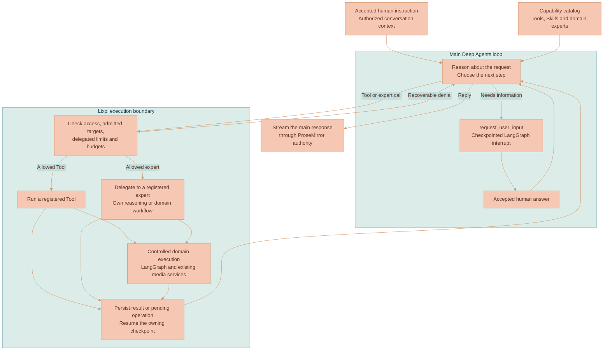

# LLM Module

The persistent Deep Agents conversation runtime and controlled LangGraph workflows for context resolution, multi-model media generation, Asset lineage, provenance, provider usage, and cancellation.

## Conversational workspace

`agent/` owns the persistent Deep Agents conversation runtime, which serves every workspace. The versioned conversation NATS endpoints accept a rich user message, reference identities and settings revision. Acceptance commits the command, duplicate-submission receipt, user message and dispatch intent before acknowledging it. The conversation Asset is created on the first accepted message and does not need a canvas node.

The root instruction asks for action results and meaningful progress in product terms. Routine identifiers, hashes and tool mechanics stay in private context unless technical details are requested or needed for a specific diagnostic. Errors are explained from confirmed facts without guessing at authorization or configuration. An unavailable request-authorization service, an invalid authorization request and a policy denial have distinct durable model-call errors and visible messages. None of these failures submits a model request.

The [agent reasoning and execution](#agent-reasoning-and-execution) flow shows how the main agent chooses work through the unified Capability catalog while Lixpi enforces access and execution limits.

The DynamoDB Agent-Conversations table stores execution metadata, ordered events, the queue, operation receipts and LangGraph checkpoints. Large checkpoint and tool payloads use retained content-addressed Blobs. A DynamoDB dispatch outbox feeds the JetStream conversation queue. The dispatcher does not poll it: each API process sweeps the due partitions once at startup to recover rows a crashed process left behind, then sweeps again only when it commits a new due row, when the earliest future due time it saw arrives, or one second after a failed sweep. An idle API never queries the outbox. The retained, disabled media-render integration uses the same relay for its own due partitions. A renewable owner lease and monotonically increasing epoch fence every checkpoint, mutation and operation continuation. The transcript projector writes the server-managed conversation document from durable messages using the shared Markdown/ProseMirror assembler.

Outbox sweeps run in the service's startup context, so closing the request that scheduled a sweep cannot cancel publication of its committed dispatch. The worker rechecks account admission for the stored command before it executes the turn.

Model-facing tool results larger than 8 KB carry a private result reference and complete identity fields. `read_tool_result` retrieves bounded structural pages or exact JSON character ranges from the same context namespace, rechecking the continuation and source access. Reads begin at the root structure and follow its exact pointers and page offsets. Invalid read arguments return recoverable tool errors; authorization, source-integrity, and Stop failures still end the invocation. Native checkpoints retain the complete result and tool-call pairing, including asynchronous completion overlays. Model-facing tool schemas follow the active action scope at every call. A fenced, definitively unsubmitted model call records zero usage and completes its authorization; a dispatched call with an uncertain outcome remains blocked from automatic retry.

Media references with an omitted rendition name identify `original`, including when Discovery and an Artifact dependency refer to the same source. Context identity still distinguishes other renditions, Blob hashes and document versions. Initialization restores still-authorized attachments from the bounded retained message history before building the agent's source inventory, including when a native checkpoint resumes. The inventory links source identities to their originating human messages with bounded text excerpts, so a follow-up can refer to an earlier image without another attachment. A current accepted rendition takes precedence over an older rendition of the same Asset. Historical references must still match their accepted source identity; unavailable or changed references are not admitted. An unknown `inspect_inputs` target returns a recoverable tool error without reading or admitting that Asset. Access revocation, source-integrity failures and continuation fences remain enforced.

Conversation snapshots open at the latest bounded message page and expose a conversation-bound cursor for `conversation.messages`. History pages preserve storage order independently of imported message IDs. Snapshot reads retry if metadata changes during assembly. List, transcript and replay responses enforce serialized byte limits; queue summaries omit rich turn payloads. Replay validates every event sequence and requests a snapshot when retained events contain a gap.

Each accepted turn fixes its model preferences, references and initial context mode. It retains the synchronized reasoning controls and resolved Bedrock model ID before inference, so a resolver refresh cannot change an uncertain request's receipt identity. A changed catalog model version requires a new user instruction. Explicit mode admits attached sources and authorized conversation outputs; discovery and mixed modes additionally expose bounded workspace discovery. An active context-mode change takes effect at the next safe model boundary. The runtime rebuilds native context and scratch from admissible history and minimal paired action receipts, retaining the execution, budget and operation identities. Discovered inputs, tool arguments and generated summaries do not cross into Explicit mode. Uncertain model or operation outcomes block the rebuild. Source content cannot grant tool authority. The model adapter makes individual Anthropic Bedrock calls through existing provider-usage authorization and measured usage reporting. Metrics identify the provider model version; canonical selections remain in workspace metadata. An uncertain submitted call is never automatically repeated. Budgets cover model and tool calls, including compaction.

Capability modules publish agent Tools, domain experts and read-only Skill resources. Each turn retains its sealed Skill paths and bytes, so a package update cannot rewrite instructions or relative resource links during recovery. Installers declare a native Skill name and a complete resource-ID-to-relative-path map. The agent filesystem mounts each bundle under `/skills/<capabilityId>/<skill-name>/`, and the native loader receives that directory directly. Its `SKILL.md` has YAML `name` and `description`; the name matches the containing directory. Missing or invalid bundle maps fail with an explicit Skill diagnostic. Resuming a turn and invoking the model recheck current access using the Capability ID. Saved snapshots retain their exact paths. Native `read_file` requests return at most 500 lines per page even when the model requests a larger window; continuation metadata identifies the next line to read. Isolated durable scratch files live under `/scratch/`; the agent has no host filesystem or shell access. The media pipeline module owns graph validation and execution policy. Media Sequence editing and export are unplugged from the application; their module, adapters and render composition remain in source for later work. Long operations return durable handles. Their terminal results resume the same conversation with paired native tool messages and recorded continuation identity.

Prepared media matrices connect frozen image sources to named inputs. Each step records its own bound image inputs in its provenance, so an image used by another branch is not attributed to that step. Execution still depends on the installed operation handler and its advertised input and provider support.

The runtime persists and projects the first provider text immediately. Later chunks share a batch until it reaches 128 characters or its 100 ms timer expires. Each batch uses the same fenced conversation writer, and model, tool and turn transitions wait for pending writes before continuing.

The agent uses the catalog's configured reasoning default when a saved composer choice cannot run on its Anthropic Bedrock route. The original turn preferences remain available to the media matrix, which resolves its own model choices.

Matrix prompt preparation retains a separate reasoning model snapshot for each preparation and selected model. Each snapshot fixes its controls and resolved Bedrock route before inference. Recovery reuses that identity and its native call receipt; a catalog version change requires a new user instruction.

Settings changes atomically retain a configuration message with the settings revision. The transcript projects it as an emphasized native ProseMirror paragraph. A projection-only dispatch updates an idle conversation without consuming queued turns or invoking a model. Entries accepted before the first message remain in the reservation until that message activates the conversation.

Steering takes effect at a safe model boundary. Stop first revokes the old continuation before another turn starts. Queue preserves accepted FIFO order, and Stop pauses queued work until explicit resume. Account cancellation reaches the model signal and fences database/output writes; the bound cleanup pauses the conversation for reauthentication. A refreshed request can resume only the original user's accepted work. Asset deletion removes retained execution, source and checkpoint references before deleting the conversation state.

The `request_user_input` tool suspends work at a native checkpointed question boundary. One matching answer can be accepted even when the ordinary queue is full. An accepted answer cannot be cancelled as an ordinary queued message; its interrupt receipt prevents a second answer. Its accepted answer replaces the pending native tool result; the answer overlay, queue removal and answer-turn completion commit together. Recovery preserves the original turn, deterministic permissions and budget instead of repeating finished tools. Explicit Continue after a budget limit creates a linked budget allocation while retaining the execution run, turn, continuation epoch and native checkpoint. The allocation receipt, answer completion and response pointer commit together, so duplicate answers or lost acknowledgements cannot reset counters twice. Each allocation has its own checkpointed budget question; completed tool results and prior native answers survive repeated continuation. Terminal failures persist both structured run errors and a visible assistant message, so reconnect does not erase the explanation.

## Agent reasoning and execution

The accepted human instruction enters `createDeepAgent` directly. The agent decides whether to answer, inspect available context, use private scratch or todos, ask a question, invoke a Tool, read a Skill, or delegate to a domain expert. There is no preliminary intent-classification model call. Ordinary context compaction remains part of the agent harness and uses the same metered model-call infrastructure.



| Component | Responsibility |
|-----------|----------------|
| Main Deep Agent | Interpret accepted human instructions and decide what work is needed. |
| Capability catalog | Describe the available Tools, Skills and experts, including their owned execution contracts. |
| Execution boundary | Enforce current access, source admission, delegated limits, continuation fences and budgets in code. |
| Domain expert | Perform a delegated task within its declared tools and the caller's limits, returning its result to the main agent. |
| LangGraph and domain services | Control workflow steps, durable pauses and domain-specific execution beneath the agent's decisions. |

### Requested work and permissions

The main agent interprets whether the human requested an action. Source documents, retrieved content, Skill resources, expert results and tool output are context, not new human authorization. A model selection or attachment alone does not request generation.

Tool declarations describe the operation they perform. They do not classify the whole conversation or prevent a question from requiring inspection, scratch files or todos. Invalid arguments return the native schema diagnostic, including the rejected field and accepted enum values, so the agent can correct the call before execution. Workspace mutations and paid media operations still pass the normal typed validation, account and workspace checks, Asset authorization, operation receipts, and execution budgets.

A requested mutation can target an Asset that the agent discovers within the permitted context. Every operation rechecks admission and access. Explicit context admits attached inputs and authorized conversation outputs; discovery and mixed context can admit workspace discoveries. An arbitrary Asset ID in model output does not admit that Asset. Changing context mode or revoking access can therefore reject a target that was available earlier.

A delegated workspace or domain expert cannot widen its caller's allowance. Read-only delegation prevents workspace mutations and media execution while retaining private reasoning tools. Family limits narrow which registered operations a child may perform. The agent's own uncertainty is resolved through `request_user_input`; there is no model-reported confidence threshold acting as a permission gate.

### Clarification and recovery

`request_user_input` pauses the active graph at a checkpointed boundary. Its matching answer resumes the same accepted execution, continuation and budget. Completed tool results and pending-operation identities survive the pause. A new unrelated instruction uses the normal steering or queue contract.

Existing unfinished turns can contain a persisted `INTENT#turnId` decision from the previous runtime. That decision remains a compatibility limit on the original turn, including its operation families and mutation targets; recovery never invokes the classifier again. A saved classifier-generated question completes its existing interrupt and treats the accepted answer as the next human turn. New turns do not create classifier records.

Each actual model invocation, including expert reasoning and compaction, uses its own provider-usage authorization identity and durable response and usage receipts. Recovery reuses a saved response. A submitted request with an uncertain outcome is not automatically repeated.

## Storage contract

- A conversation is an Asset with a `conversation` ProseMirror role.
- Every concrete image/video run receives a pending output Asset before provider fan-out.
- Media bytes and document/provenance JSON are organization content-addressed Blobs.
- Canvas nodes contain `assetId`; node IDs remain independent topology identities.
- The conversation streams once. Output provenance is projected from the settled conversation Asset at terminal state.

There is no document/chat-thread persistence model or workspace file storage adapter in this module.

## Entry points

`createLlmModule()` returns:

- `process()` for a single reasoning request;
- `processMediaGenerationMatrix()` for shared-preflight multi-model fan-out;
- `seedCapabilities()` for package seeding after every isolated module has registered its actions;
- `stop()` and `stopMediaGenerationMatrix()`;
- `shutdown()`;
- `getSubscriptions()` (currently empty because the API gateway invokes the module in-process).

The NATS gateway authenticates the conversation Asset, acquires its workspace lease, obtains the authoritative `organizationId` from the Asset, and renews the lease while the workflow runs.

With account admission enabled, detached conversation and matrix jobs carry an indexed account scope independently of the initiating NATS handler. Provider graphs combine its cancellation signal with any parent workflow signal, and matrix preflight passes it into context resolution and Capability execution. The database adapter rejects user transactions from a cancelled scope, and configured NATS publication guards reject late output. Account cancellation skips normal stream completion, stops lease renewal and runs bound terminal cleanup for the request's existing records. Worker enforcement and incurred-usage accounting are part of the coordinated admission release and must be verified before enabling its deployment flag.

## Workflow

Provider adapters bind usage settlement to the original request authorization before making a paid call. Reported usage is recorded before result delivery, so account cancellation can suppress output without discarding already measured work. The bound settlement can only record usage; it cannot authorize another provider request or publish a user result. The final graph node skips dimensions already settled by the adapter. Provider operations that stop before returning measurements need vendor reconciliation; no usage is inferred from cancelled output.

```text
validateRequest
  → resolveWorkspaceContext
  → resolveCapabilities
  → executeRequiredCapabilities
  → resolveMediaBranch
  → streamTokens
  → planMediaBranchLineage
  → generate_image | generate_video | skip
  → calculateUsage
  → cleanup
```

Context snapshots contain only nodes and media candidates explicitly attached to the submitted turn. The API filters candidate snapshots against their explicit-reference allowlist before Asset authorization, ignores edge topology for context, and never ranks the rest of the canvas. It also extracts typed prompt-reference atoms from the authoritative latest user message, reauthorizes them, and materializes Asset-only media references without inventing canvas nodes. Media-enabled turns merge prompt references and composer context into the explicit candidate set; text-only reasoning turns attach the authorized image or representative frame directly to the latest user message. Video candidates use representative-frame/poster renditions; explicit extension resolves the authorized source video Asset to canonical/original MP4 internally.

Capability resolution maps selected top-level modules to their module-internal entry packages, accepts only structurally standalone Tool/Skill references on those categories, captures current manifest hashes, authorizes the transitive closure, enforces dependency and aggregate resource limits, and seals the plan. `required` Tools run before provider streaming. `model-required` Tools run exactly once inside each selected reasoning provider's agent loop before its final response, while `model-choice` Tools remain optional. Capability-only Artifact output is staged during that Tool round and attached to the Workspace only after the provider continuation has ended and its pending conversation writes have drained. The reasoning model also receives `search_capabilities` and `use_capability`; model-selected visual Tool output is folded back into the same provider state before lineage planning and generation. Transient media providers cannot recurse into those functions.

Every registered Capability module has a validated description sheet. Authorized module catalog responses carry its purpose, expected inputs, best-result guidance, limitations, and qualitative execution characteristics to browser hover and focus cards.

Static system prompts, Tool descriptions, schemas, Skill resources, resolver instructions, and structured-VLM instructions state only structural contracts. They contain no illustrative subject, object, setting, action, aesthetic, creator, brand, equipment, sample prompt, or fixed semantic negative list. Concrete prompt content comes from the current user request, authorized reference evidence, or a Capability resource with an explicit role. Required schema literals and Capability-domain terms remain explicit.

## Streams

Live interaction events:

```text
ai.interaction.chat.receiveMessage.<organizationId>.<conversationAssetId>               # internal canonical
ai.interaction.chat.receiveMessage.<userIdToken>.<organizationId>.<conversationAssetId> # authorized browser relay
```

Pipeline replay logs are keyed by workspace and conversation pipeline ID. `StreamPublisher` writes replay before live publication and preserves per-`mediaRunId` event ordering without serializing sibling runs.
Request completion first publishes an authoritative terminal canvas snapshot, including matching generated outputs even when their geometry did not move, and only then publishes `MEDIA_GENERATION_REQUEST_COMPLETE`. The browser therefore receives terminal output progress before it tears down branch-run ownership.
The authorized browser interaction and conversation-document relays refresh authorization against the request's single Workspace and conversation Asset on a short interval, then forward events directly between refreshes. They carry the originating `workspaceId` and must never rebuild account-wide Workspace/Organization requester context for stream keepalives or ProseMirror step delivery.
Transient image/video providers forward media events to their owning reasoning provider; only that owner live-publishes the mirrored event and terminally settles the durable request, preventing both duplicate delivery and premature failure while a successful provider result is returning. Matrix reasoning owners mirror provider lifecycle events to both the shared ProseMirror writer and the live response subject, while ordinary reasoning tokens remain single-published by the child stream.

Conversation document steps use:

```text
asset.document.steps.<organizationId>.<conversationAssetId>.conversation               # internal durable
asset.document.events.<userIdToken>.<organizationId>.<conversationAssetId>.conversation # authorized browser relay
```

`AiChatProseMirrorStreamAssembler` is the single writer for AI transcript steps. It parses streamed Markdown, updates reasoning/trace/generated-output nodes, and publishes expected-sequence step/control events through `AssetProseMirrorStepTransport`. Media generation trace blocks are keyed by the full media run inside a reasoning section, so image/video model fanout preserves one final prompt and trace per output instead of overwriting sibling variants. Capability generation traces use the same collapsible node and retain Tool identity, run ID, output Assets, and workflow-step summaries beside the provider's continued assistant response.

Conversation snapshot settlement is serialized per organization, Asset, and document role. Every attempt reloads the current Asset revision before the transaction, retries bounded revision conflicts, and suppresses logging only for those expected conditional losses; non-conditional transaction failures remain terminal and logged. Accepted client step batches are coalesced behind one idle-debounced settlement per Asset role. Final-response persistence cancels that pending idle settlement before using the same coordinator, so it cannot race a queued client settlement inside one API process. Structured settlement logs identify the trigger, coalesced batch count, current-Asset read origin, attempts, version, and duration.

Matrix requests carry an explicit `outputMediaTypes` list. Lineage planning, pending Asset creation, provider tool availability, and fanout use only those output sections; a default singular model from an inactive section must not become an extra branch assignment.
Before provider invocation, the API rebuilds messages and the current prompt from that authoritative conversation document; browser-serialized transcript history and prompt fingerprints are not trusted.

Generated-output replay is an explicit exception to reasoning prompt creation, not to authorization. The API validates that the requested preserved lineage marker exists in the editable Workspace and belongs to the supplied branch. A replay matrix carries output-scoped final media prompts keyed by reasoning model, media model, and modality. The provider graph skips `streamImpl`, injects each prompt only into its matching media fanout, retains the original model parameters, and creates replacement output Assets under the preserved marker. Its lineage plan includes the preserved regeneration target so clients never treat that committed marker as temporary UI geometry; all clients consume the same API-persisted marker and generated-media coordinates. Normal prompt regeneration does not use this replay contract and therefore creates a new API-planned lineage.

## Media preflight and Asset creation

Provider request authorization runs before media preflight. A denied or unavailable authorization settles existing durable runs as failed and reports an authorization error. The canvas receives the terminal request state even when no provider or shared-preflight publisher started.

Media-model requests first cross the durable [media reference and moderation boundary](../../../../documentation/media-generation/MEDIA-REFERENCE-IDENTITY-AND-MODERATION.md). The NATS handler authorizes structured ProseMirror references and explicit media context chips, assigns every selected Asset a `REFERENCE_n` binding, runs bounded local free-form matching, stores the immutable checkpoint, and returns before any reasoning/media call when ambiguity exists. Typed Capability, Tool, Skill, and Capability Artifact labels remain visible prompt text but are segmented away from free-form media matching, so an Artifact title cannot be mistaken for one of its cited media Assets. Candidate snapshots collapse duplicate candidate IDs by underlying Asset identity before branch resolution or provider compilation, preserving active-target identity and merged context roles. An ambiguous resolver result opens the branch picker only when at least two authorized Assets remain; a single underlying Asset stays attached as context on a targetless fresh branch. Provider-safe messages and candidate/workspace snapshots exclude Asset titles and filenames. Model-authored and replayed final media prompts are sanitized back to their authorized `REFERENCE_n` aliases before trace emission and provider dispatch; leak assertions still run after compilation and at provider transport. System-owned generated-media placeholder names are still compiled and sanitized as aliases, but their normalized `generated` token is not treated as an identity-bearing forbidden name because it also appears in trusted structural fields such as the `generated-variant` role hint.

The browser allocates the durable `generationRequestId` before submission and uses it for preflight marker ownership, the top-level request, matrix fan-out, and stop. When the explicit reference graph has one generated candidate and every other selected reference is already part of that candidate's source ancestry, the candidate is a provisional structural target. `MediaBranchLineagePlanner` immediately plans a continuation from it before semantic resolution finishes; a later resolver result may still replace that provisional choice. Base references and genuinely ambiguous generated candidates never become lineage parents from selection alone.

An `edit_existing` branch resolution is never targetless. If structured resolution omits `targetCandidateId` while the snapshot has an active target, sanitization restores that exact candidate as both edit target and continuation parent; without either an explicit or active target, resolution fails before Capability execution. `ImageRouter` independently resolves the same target from LangGraph state before assigning Character Creator reference roles, so a prior composite cannot silently degrade into an `original-source` input.

`MediaGenerationRequestService` owns CAS status/run transitions, checkpoint retention, operation-node projection, same-request ambiguity/verification resume, explicit cancellation, and terminal failure of any pending/running durable run left behind when the owning reasoning orchestration exits. Nested image/video provider cleanup never runs that request-level sweep; the router records the provider result before the reasoning owner performs terminal cleanup. A later explicit provider completion may repair only the synthetic `media-run-unsettled` failure created by that sweep; real provider failures and cancellations remain terminal. Final Asset attachment also settles active output-node progress as completed, so the materialized output cannot remain in a receiving state while later request cleanup drains. Authoritative generated-output rejection uses current-revision cancellation when final media or sealed provenance is still unavailable, then removes the pending Asset projection and its generation-owned references through the normal review transaction. The terminal sweep preserves reference-resolution and provider-verification pauses, and publishes one problem transition per failed run so persisted canvas progress and replay/live recovery cannot remain active after the request-level completion event. `MediaGenerationRequestEventLog` owns non-expiring wait events and tokenized replay/live recovery. Provider adapters register through `MediaProviderDefinition`; missing profiles fail startup, current moderation settings are explicit, normalized problems are sanitized, and automatic paid retry is always forbidden.

Reference ambiguity is resolved one prompt binding at a time. Every projected or replayed action carries one atomic `(bindingId, candidateAssetIds)` pair for the first unresolved binding; resolving it publishes the next pair rather than retaining the previous binding ID or combining candidates from unrelated prompt phrases.

`MediaBranchLineagePlanner` enumerates reasoning/media axes and returns marker topology plus one `MediaRunLineageAssignment` per concrete output. Each assignment includes its stable output `assetId`. Assignments and branch-marker provenance records carry the canonical unique set of selected `referenceAssetId` values plus the node-backed `referenceNodeId` subset. Prompt documents separately preserve every inline mention occurrence; execution timelines consume the canonical lineage set and render it once under reference resolution. Asset-only references contribute provenance but never canvas topology.

Media type is explicit request state authored by the composer Image/Video switch. Prompt wording and attached source-video context never switch modality. Matrix normalization keeps only the model ids for `mediaGenerationMode`, validates that active mode's per-model configuration against synchronized controls, and emits only that modality's durable request, pending Assets, lineage assignments, and provider Tool. The video Tool may also return a provider-neutral negative prompt derived from the current request; all reasoning adapters preserve it through provider state, and `VideoRouter` adds it to the transient video configuration for providers with a native field. A Google reasoning run with video as its only media Tool retries with `generate_video` as the only allowed function when automatic Tool selection misses; a second miss fails explicitly instead of publishing a zero-assignment lineage plan. The legacy scalar path is deterministic when both old selectors are present and selects image rather than inspecting prompt text. Character Creator is image-only: request routing selects the Tool before provider execution, retains the selected reasoning/image axes, and removes every video model and video option before matrix normalization or scalar provider setup.

Ordinary image routing packages source and Capability references into the `imageGenerationReferences` LangGraph channel. `BaseProvider` resolves and fingerprints them once into `resolvedImageGenerationReferences`, then the selected `MediaProviderDefinition.imageReferenceAdapter` enforces the model's synchronized `imageReferenceCapabilities` profile and records its result in `imageReferenceAdaptation`. Identity and source relationships are therefore state, not provider-specific prompt inference. They are reserved before optional style, structure, or pose controls, and each provider only serializes the adapted references to its native API.

Character Creator instead forwards a typed `capabilityMediaExecutionPlan` plus the preflight-preserved user prompt. `BaseProvider` carries both into every reasoning child and routes the plan directly to image fanout; execution does not depend on the reasoning model voluntarily emitting `generate_image`. `ImageRouter` accepts the typed plan as the authoritative invocation and builds one generic shared Capability media state containing the provider-safe raw user prompt, source subject-identity classifications, all sibling Capability instructions and references, and every Capability output for the request. A reasoning model's generated media prompt remains non-authoritative enrichment and cannot replace that raw request for Capability-owned media execution. The package-owned strategy consumes the shared state, so an output-owning Capability cannot silently discard contributions from another Capability selected in the same prompt. Its module definition publishes `CharacterSheetStrategy`; `CapabilityModuleCatalog` installs it into the registry used by `ImageRouter`. The API never imports the concrete strategy. Provider adapters still consume the same provider-neutral reference roles.

Shared preflight creates pending Assets with:

- workspace scope/catalog and conversation/media surface reference;
- owner ACL and Meta projection;
- `creating/processing/building` states;
- `sourceConversationAssetId`;
- `parentAssetId` and `sourceAssetIds` resolved from authorized node-to-Asset maps;
- generation/reasoning/media IDs and prompt fingerprint.

The Character Creator runtime reauthorizes every source Asset through its injected API port, selects `canonical` then `original`, and bypasses the ordinary attachment downscale. When a source is a Character Creator composite, the resolver expands its separately stored original-source provenance and panel components instead of treating the flattened sheet as the only reference. The selected reasoning model produces structured observed, inferred, coverage, crop, palette, material, conflict, and edit-target-authority evidence. It classifies the prior sheet as `preserve-panel`, `identity-only`, `discard`, or `not-present`. Identity-only approval yields one cropped `edit-target-identity` face reference for the head shot and no rejected edit-target pixels for body shots; original Assets remain independent `original-source` appearance evidence. Those roles enter every nested provider through LangGraph's image-reference state before provider adaptation. Lossless role crops and newly generated panel candidates live only in organization-scoped transient storage.

`CapabilityMediaDagRunner` executes Character Creator's configurable 3-to-10-shot graph with provider-scoped concurrency and zero automatic retries. The default graph renders three required generated anchors in sequence: the neutral-front identity portrait, the front full-body outfit view, then the back full-body outfit view. The front shot consumes the portrait anchor, and the back shot consumes both earlier anchors. Every optional shot consumes all three anchors, so unrelated optional shots can run in parallel as soon as the back anchor completes. Dependencies and generated-reference bindings are declared by the Capability's shot graph; the runner never attaches every earlier output implicitly. For edits of a prior composite, a conservative classifier chooses whole-sheet regeneration unless the request isolates compatible panel changes. Durable unaffected panels are passed into the runner as completed initial results, satisfy downstream generated-reference bindings, and receive no provider call; missing or affected panels still execute normally. Free-form prompt text can spend additional slots on belongings, turnaround angles, face details, outfit construction, materials, or poses. Each generated shot receives one provider attempt. Character evidence and comparison calls set the structured-VLM transport to single-attempt mode as well. Every provider image partial replaces that panel in a progressively recomposed sheet; the terminal shot replaces its last partial. Anchor partials are presentation-only and cannot satisfy the DAG binding or release dependent provider work. The runtime then runs structured VLM assessment and optional NEX YuNet/SFace comparison without modifying the pixels. Failed generation or comparison is traced and surfaced to the user; every successful or reused shot still reaches the final composite.

A valid categorical comparison can reject a generated anchor. An unavailable or malformed comparison cannot: the completed image remains an anchor, dependent shots continue, and the comparison problem appears only as review metadata.

The Sharp compositor reads the owned SVG layout resource, derives a compact grid from the requested shot count, removes near-white outer margins, fits available subjects into their cells, renders no typography or diagnostic decoration, and verifies a 3840x2560 PNG. Capture-only shot providers forward their raw partials to the Character Creator adapter instead of publishing isolated panels as top-level output. The strategy recomposes the full sheet, and the owning `ImageRouter` publishes each composite through transient image publication on the preassigned Asset. Before `ImagePublisher.complete` settles the final PNG through the ordinary Asset path, the router stores every final panel as an independently addressable Asset blob and atomically attaches generic media-composition metadata containing the Capability id, original source Asset ids, component roles, and hashes. The image-generation trace carries the final comparison summary with `automaticRetries: 0`. A cleanup ledger removes every transient source crop and newly generated candidate after success, error, or cancellation.

Providers and browser code must never synthesize assignments, marker IDs, output node IDs, or output Asset IDs.
Request creation assigns every concrete media run its stable media-run, operation-node, output-node, and Asset IDs and persists the pending image/video node immediately. A lineage-plan canvas write persists branch markers and enriches those existing output nodes with final topology; the first media event does not create them.
A matrix reasoning child never completes the shared generation request. It may settle only its own skipped branch. After every reasoning child finishes, the matrix orchestrator first fails any durable run that is still pending/running, then publishes the single request-level completion. Preflight failure applies the same durable terminal sweep before the error escapes.
A reasoning-only matrix has no concrete media assignments, so it creates no pending output Assets or media-lineage canvas markers.

## Image and video publishers

Image partials are ephemeral Object Store objects and are never Blob renditions. Final publishers:

1. validate provider bytes;
2. store/register the original Blob on the preassigned Asset;
3. start the rendition service;
4. project and attach the final canvas node through the Asset transaction;
5. publish `IMAGE_COMPLETE` or `VIDEO_COMPLETE` with `assetId` and authoritative canvas geometry;
6. materialize terminal provenance, queuing a rebuild on failure.

Canvas attach failure propagates; the publisher does not emit a fabricated durable completion.
A failed concrete media run is settled independently: the API detaches only that run's pending Asset placement and mutates the Workspace canvas in the same Asset-reference transaction, rebalances the remaining siblings, and publishes `CANVAS_GEOMETRY_RESOLVED`. Direct Workspace mutation cannot remove Asset-backed nodes. The browser never saves a locally reconstructed failure topology, so one failed provider cannot delete or overwrite sibling runs from a newer API canvas revision.

## Provenance

`asset-provenance-materializer.ts` projects only the matching reasoning/media run from the settled conversation Asset into a schema-valid, title-free ProseMirror provenance snapshot. Sibling generation trace blocks are filtered by media-run identity even when they share one reasoning run. It embeds that run's terminal recursive `generationProgress` on its generated-media atom; the shared `Understand request` summary captures only assistant content before the first generation invocation, never the generation trace's media prompt. Every reference-handle collection is built from the canonical unique lineage Asset set rather than prompt mention occurrences. The sealed snapshot Blob is stored in `documents.provenance`. A completed run retries while the rich conversation projection is still settling, then uses a minimal valid terminal projection only after bounded retries are exhausted. Failed/cancelled runs receive the same minimal valid terminal projection and media atom when the conversation projection has none. Deferred reconstruction does not depend on pipeline events that normal cleanup may already have purged.

Request-level failure/cancellation settles every unfinished planned Asset. Assets whose original already settled rely on their per-publisher provenance job/retry.

Pipeline cleanup may discard source events after terminal delivery because deferred provenance reconstruction reads the settled conversation Asset.

Generated media partials never travel inside pipeline, ProseMirror, or live NATS event payloads. Providers write each revision to an immutable run-scoped object in the organization transient-media Object Store and publish only an authenticated API reference. After a replacement is stored, the superseded revision is deleted; terminal media clears the last partial immediately, with provider teardown retrying any failed cleanup. The mechanism is media-type agnostic, and final media remains available only through its settled Asset rendition.

Asset-document resume follows the same payload boundary: core NATS returns snapshot metadata and byte-bounded replay pages, while the browser fetches the Blob-backed ProseMirror snapshot through the authenticated Asset HTTP route. Conversation growth cannot turn a resume reply into a `max_payload` failure.

## Cancellation

Matrix stop marks the request publisher and request group as cancelling before aborting provider groups. The authenticated stop handler starts provider shutdown, root-workflow shutdown, and current-revision durable cancellation together; once the durable request is `cancelled`, late provider status and progress writes are ignored. Provider returns carry an explicit user-cancellation marker, including nested Capability image providers, so an empty stopped result cannot be reclassified as missing provider output. Provider aborts inherited from that user stop are cancellation control flow: they do not publish `ERROR`, `IMAGE_ERROR`, or `VIDEO_ERROR`, do not create failed recovery cards, and do not run the non-cancellation terminal sweep. The matrix `finally` consumes the cancellation latch, patches cancelled state into the persisted conversation Asset through the system snapshot path, drains projection/document queues, and releases the lease. Cancellation deletes unfinished image partials and pending videos from both live and persisted ProseMirror state, while preserving terminal media. The authenticated stop handler then removes every persisted marker, generated output, and generation-owned operation node carrying the request ID. Asset-backed nodes are detached through Asset transactions, and generation-only conversation surface references are removed so abandoned output Assets can be deleted.

If workflow cancellation fails or no live publisher exists, the stop handler still removes the persisted request projection. It never depends solely on browser state.

## File layout

```text
llm/
├── graph/
│   ├── state.ts
│   ├── stream-publisher.ts
│   ├── pipeline-event-log.ts
│   ├── workspace-context-resolver.ts
│   ├── media-branch-resolver.ts
│   ├── image-publisher.ts
│   └── video-publisher.ts
├── lineage/
│   ├── media-branch-lineage-planner.ts
│   └── media-generation-run-planner.ts
├── orchestration/media-generation-matrix.ts
├── providers/
├── structured-vlm/
├── tools/
├── prompts/
└── usage/

../../../packages/lixpi/capability-system/    # reusable validation, module registry, workflow/media DAG runners, and dispatcher
../../../packages/lixpi/capability-system/src/capabilities/ # self-contained modules, including Character Creator runtime
../capability-system/                         # API storage, NATS, LangGraph, and platform-port adapters
../capability-system/character-creator-platform-adapter.ts # Character Creator host ports; no capability orchestration
../installed-capabilities.ts                  # built-in Tool and Skill composition root
../prosemirror/ai-chat-stream-assembler.ts
../prosemirror/asset-prosemirror-step-transport.ts
../services/asset-canvas-projection.ts
../services/generated-asset-storage.ts
../services/asset-provenance-materializer.ts
```

## AWS Bedrock inference

Anthropic and Stability inference can run through AWS Bedrock instead of each vendor's own API. A provider opts in through its own env flag, separately from its api key:

| Flag | Effect |
|------|--------|
| `ANTHROPIC_USE_AWS_BEDROCK_INFERENCE=true` | `AnthropicProvider` and the structured-VLM client invoke Bedrock, and `ANTHROPIC_API_KEY` goes unused |
| `STABILITY_USE_AWS_BEDROCK_INFERENCE=true` | `StabilityProvider` invokes Bedrock, and `STABLE_DIFFUSION_API_KEY` goes unused |

`STABLE_DIFFUSION_USE_AWS_BEDROCK_INFERENCE` is accepted as an alias of the Stability flag, so you can keep the flag next to the api-key name your `.env` already uses.

Bedrock requests go to `AWS_REGION` and are signed with AWS credentials instead of an api key. Locally that is the SSO profile named by `AWS_PROFILE`, resolved against the developer's `~/.aws` SSO cache that docker compose mounts into the container. On AWS it is the ECS task role, which carries Bedrock invoke and catalog-read permissions.

`providers/bedrock-inference.ts` owns the flags, the region, credential resolution, and the translation from a catalog model id to a Bedrock model id. It discovers that translation from the Bedrock control plane and caches it per process: it normalizes the catalog id to a Bedrock model-name stem, matches both current pinned dateless IDs and legacy version-suffixed IDs from `ListFoundationModels`, and for models that Bedrock does not serve on demand it picks the cross-region inference profile covering the model. New model releases need no code change because of that, and only a renamed id needs an alias entry.

Bedrock serves Stability as text-to-image and image-to-image only, so it has no equivalent of the `control/*` endpoints the direct API path uses. Reference-driven requests fall back to image-to-image with a strength chosen per routing mode, the secondary style reference is dropped, and the provider logs a warning naming the fallback. Anthropic behaves the same on both paths.

The AI Model Registry reads `ANTHROPIC_USE_AWS_BEDROCK_INFERENCE` too. With the flag on it lists Anthropic models from the Bedrock foundation-model catalog and projects both dated version-suffixed IDs and current pinned dateless IDs onto exact vendor model IDs, so persisted selections remain exact catalog keys when there is no Anthropic api key.

## Synchronized inference capabilities

The selected `AiModel` record supplies `inferenceCapabilities` to ordinary provider streams, structured VLM calls, Capability model variants, and Character Creator assessment calls. The profile controls temperature omission, provider-native thinking configuration, system-prompt support, closed-schema adaptation, and accepted input kinds. The API fails when a selected record lacks this profile. It does not infer these behaviors from provider or model names.

[`services/ai-model-registry`](../../../ai-model-registry) holds and validates the profiles before writing `AI_MODELS_LIST`. A model-specific inference rule is a field in that model's `-lixpi.json`. The API only translates the profile into provider request fields.

## Provider invariants

- Provider state updates are partial overlays; undefined fields do not erase state.
- Provider request behavior comes from the selected model's synchronized `inferenceCapabilities`; API adapters do not classify model families.
- Capability references resolve once in shared preflight to an immutable, hash-verified plan. Matrix children receive that exact plan and never re-resolve it.
- Reasoning providers expose `search_capabilities`, `use_capability`, and attached `model-choice` Tools through bounded provider-native continuation loops. Transient image/video providers never expose Capability invocation functions.
- Preflight-required Tools execute before reasoning. Model-required Tools execute inside the selected reasoning adapter with provider-native forced Tool choice, then return their structured result to the same agent loop so the ordinary assistant response continues. Every Tool action resolves through the server allowlist and emits replayable generic run events with sealed manifest provenance.
- Media-generation Tools return provider-neutral instructions and model-safe references or a typed `capabilityMediaExecutionPlan`. Shared preflight forwards that output to every selected reasoning/media child without changing the selected model matrix. `MediaBranchLineagePlanner` allocates the normal output Assets and topology before provider fanout; Tool runtimes and media strategies do not attach those outputs themselves.
- A model-required non-generation Tool may return terminal output Assets and suppress ordinary media routing when its product contract makes those Assets the request result.
- Capability-only output stages its terminal Assets until the provider continuation and conversation are durable. The registered output finalizer then attaches and publishes them; failed or cancelled continuations discard staged outputs.
- Capability output classification keeps all output Asset IDs for projection and a separate media-only list for media lineage. Non-media Artifacts never enter image/video run planning.
- Transient media providers do not emit their own top-level start/end lifecycle.
- Reference traces never contain inline image bytes.
- Provider routers receive exact preplanned run metadata.
- Every reasoning adapter measures the complete translated provider-native request against the selected model's context window before invocation, reserves its completion budget, and rejects overflow without clipping text or media inputs.
- `@lixpi/usage-reporter` authorizes provider requests before transport and records measured usage after completion. Its public results and logs contain only usage dimensions and neutral decisions.
- The estimate describes the invoked model and modality. Reasoning calls use tokens; each transient image or video provider request has its own authorization.
- Text estimates combine measured prompt tokens, a growth allowance, and the completion ceiling. Video estimates use the called endpoint's catalog usage unit and preserve the provisional-frame warning described in the package documentation.
- Usage records retain the provider request ID, authorization ID, workflow sequence, and measured modality dimensions. The API durably queues each measurement before delivery. Completion is acknowledged only after the responder has recorded every listed measurement. Additional model rounds acquire separate authorizations. Metered transport attempts do not silently reconnect under one authorization when the previous attempt's outcome is unknown.
- Every request has an AbortController and the global timeout.
- Attached Asset display titles/original filenames never enter provider-safe reasoning or media payloads; final adapters fail closed on a forbidden variant.
- Every current provider has one validated policy definition with explicit moderation, verification, retention, sensitive-data, documentation, review, and problem-normalization fields.
- Provider failures are terminal per run. Recovery requires Edit request plus a new explicit Submit; no adapter automatically retries a cosmetically rewritten prompt.
- Connection faults are the one exception, and they are not a content retry: [`utils/transport-retry.ts`](utils/transport-retry.ts) reconnects a provider operation that never produced a result, with the NATS client's backoff (500ms → 16s) under a hard 60s budget. `BaseProvider.retryTransport(operation, attempt)` applies it to every provider; a provider contributes only its own SDK's connection-error class names through `transportFaultNames`, over the shared Node socket-code layer that covers everything reached through `fetch`. Only work that is safe to run again from the start is wrapped — submits, non-streaming calls, idempotent polls and downloads. An attempt that publishes as it streams calls `markPublished()` at its first emission, which makes any later failure terminal so a retry never replays output. HTTP status errors, moderation, and quota are untouched, and an aborted run never retries.

## Related docs

- [`documentation/platform/AI-GENERATION-PIPELINE.md`](../../../../documentation/platform/AI-GENERATION-PIPELINE.md)
- [`documentation/media-generation/BRANCH-LINEAGE.md`](../../../../documentation/media-generation/BRANCH-LINEAGE.md)
- [`documentation/platform/DATA-STORAGE.md`](../../../../documentation/platform/DATA-STORAGE.md)
